# LAPORAN PEMROGRAMAN WEB - CLASS ACTIVITY 10

----
| Nama | NRP |
| ---------------------- | ---------- |
| Dea Chrisna Butarbutar | 5027241035 |
----

## SKENARIO DAN TAMPILAN

### 1. POST

Tampilan sebelum:

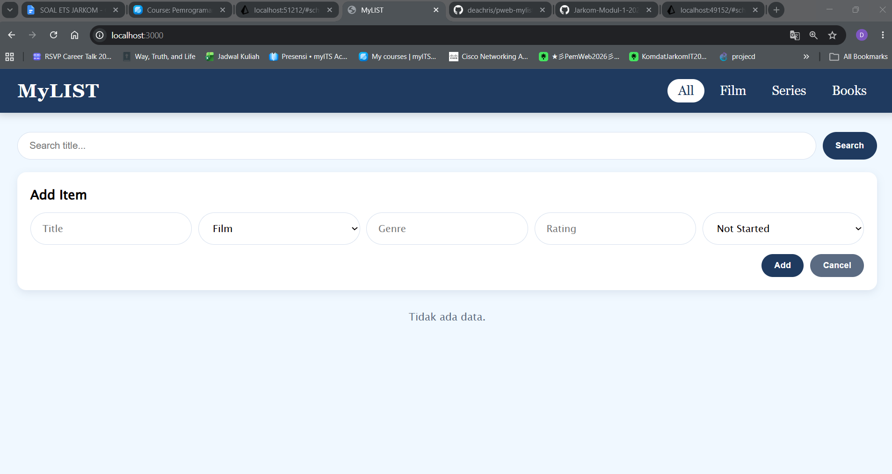
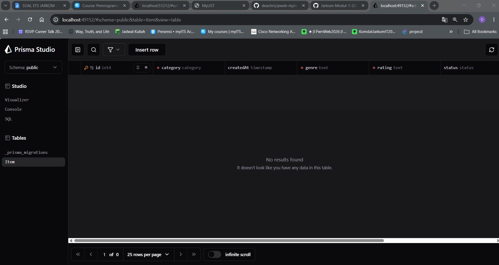

POST film Interstellar:

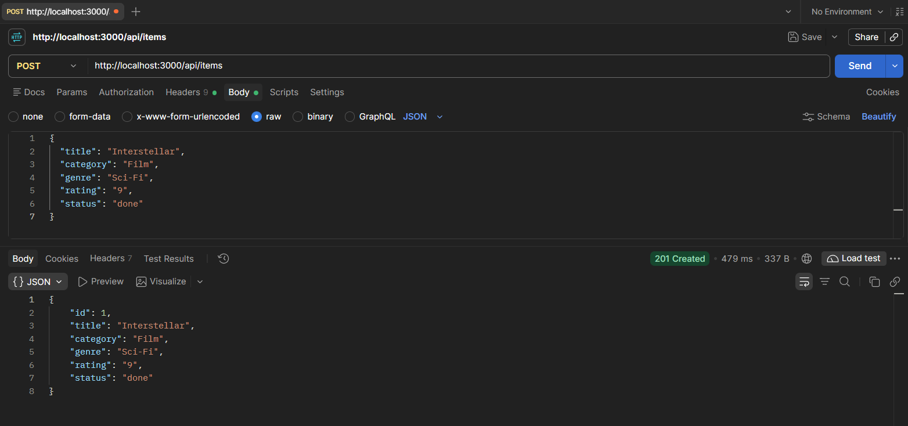

Tampilan sesudah:

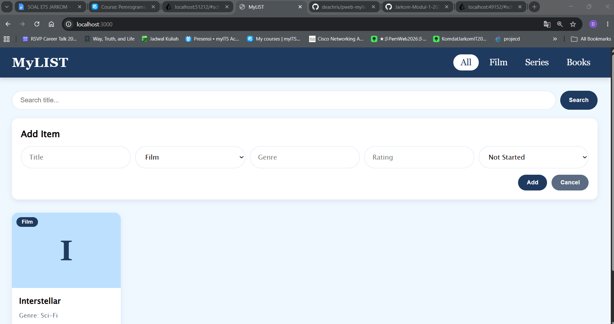
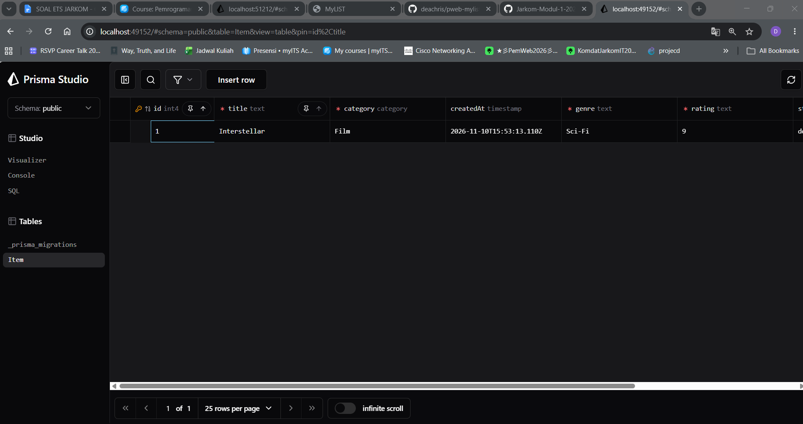

### 2. PUT

PUT film Interstellar untuk mengubah film menjadi series:
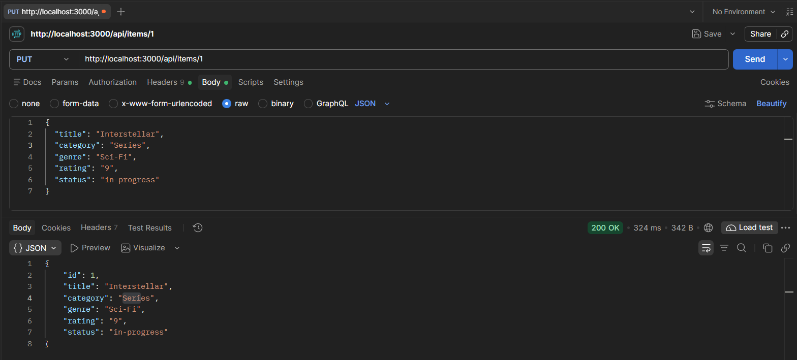

Tampilan database sesudah:

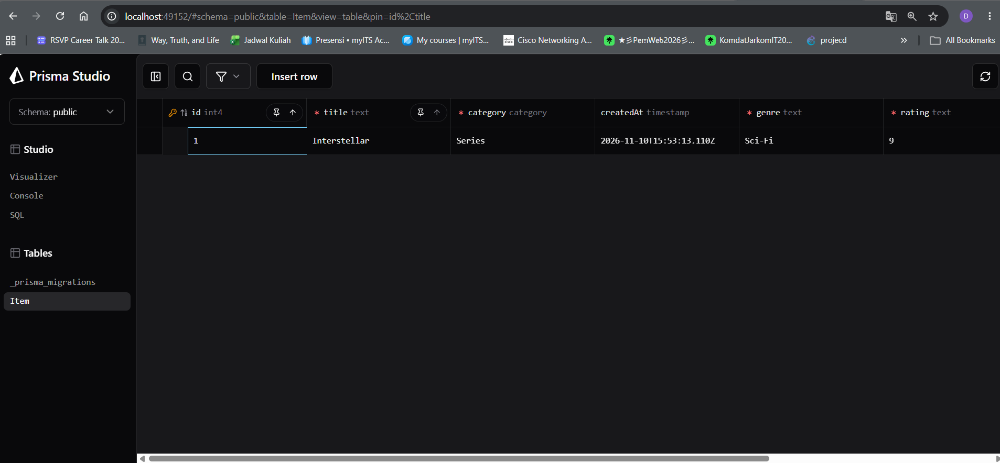

### 3. DELETE item id 4	item hilang dari list

DELETE fil Interstellar dengan id 1:

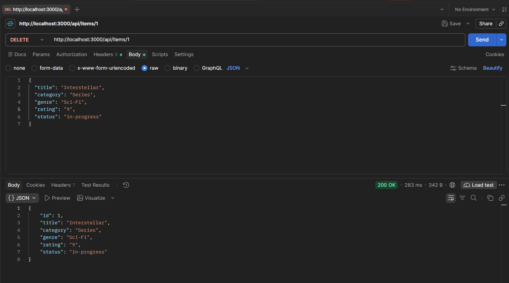

Tampilan sesudah:
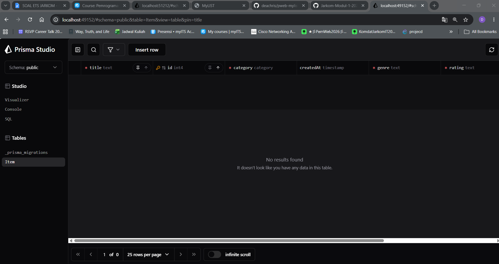

### 4. POST dengan Kategori yang Tidak Tersedia

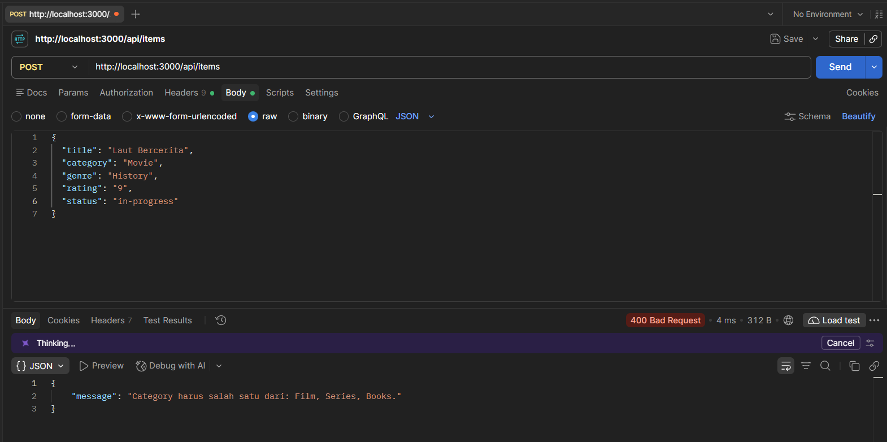

Ketika merequest dengan kategori yang tidak tersedia, maka akan menampilkan response 404 dan tidak dapat menambahkan data baru.

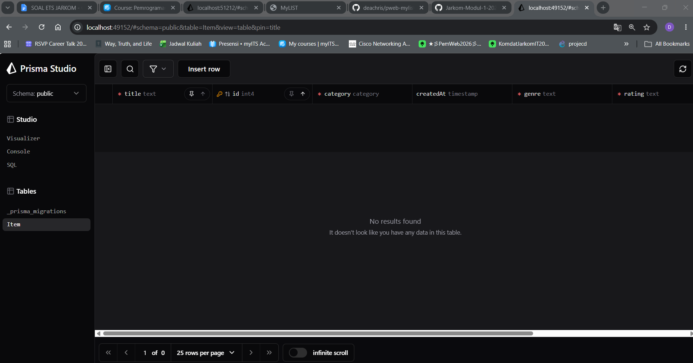

5. GET Id yang Tidak Ada

Id yang tersisa tidak ada karena sebelumnya sudah dihapus, sehingga ketika melakukan PUT ataupun GET, hasilnya akan 404 not found.